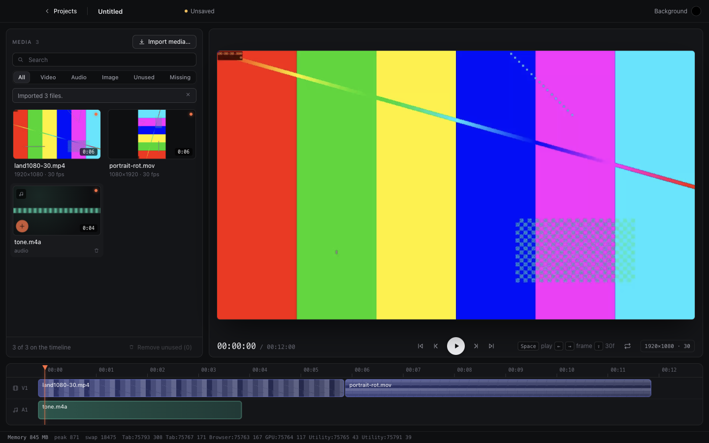
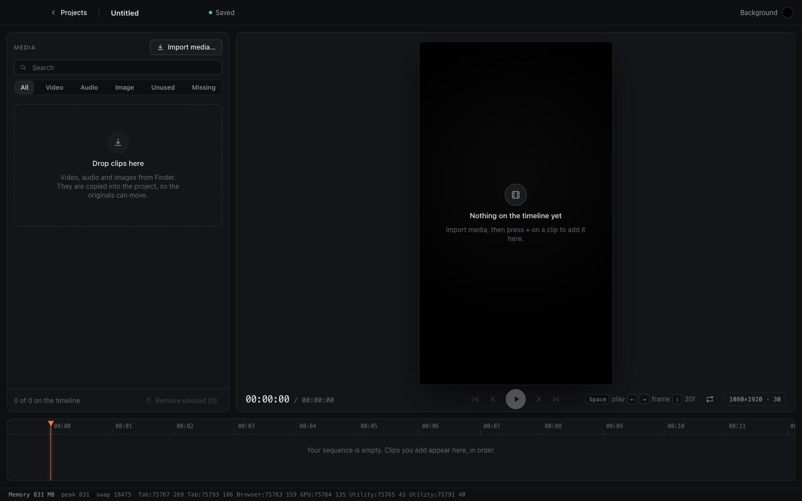

# M3 verification report

Generated 2026-11-11 13:38 by `scripts/verify/verify.py M3`.
Commit `3714f9b` (uncommitted changes present) · macOS-27.0.1-arm64-arm-64bit · ?GB RAM. The 8GB target Mac is a separate run; memory figures from other machines are indicative only.

**Result: 37/37 checks passed.**

## Static checks

| Check | Result | Detail |
|---|---|---|
| pnpm typecheck | pass | 1s |
| pnpm lint | pass | 1s |
| pnpm test (schema, store, import, crash) | pass | 1s |

## End-to-end checks (real Electron app, driven over CDP)

| Check | Result | Evidence |
|---|---|---|
| Decoded-frame cache capped at 240MB (Remotion's minimum; the plan's 200MB makes the player fall back to <video>) | pass |  |
| Bundled fonts load (Noto Sans Bengali, Bebas Neue) | pass |  |
| Empty editor shows the empty states | pass |  |
| Transport is disabled with an empty timeline | pass |  |
| Two videos and a track of audio imported with proxies | pass |  |
| Clips appended back to back on one video track, audio on its own track | pass | starts [0, 180] durations [180, 180] |
| Video track sits above the audio track | pass |  |
| Timeline shows both clips and the audio clip, total duration in the transport | pass | 00:12:00 vs 00:12:00 |
| Preview paints the first clip at frame 0 | pass | {'r': 125.4179513888889, 'g': 127.19081597222223, 'b': 124.40414930555555, 'dark': 0, 'w': 1280, 'h': 720} |
| Preview uses the WebCodecs player (no native <video> fallback, no player errors in the console) | pass | [] |
| Mount window: at frame 0 only the first clip is mounted | pass | 1 media canvases |
| Space plays and pauses | pass |  |
| Playback advances in real time (about 1.5s of frames) | pass | 43 frames in ~1.5s at 30fps |
| Paused playhead stays put | pass |  |
| Arrow keys step one frame | pass | 00:00:02 |
| Shift+Arrow steps one second | pass | 00:01:02 |
| Left arrow steps back | pass | 00:01:01 |
| End jumps to the last frame | pass | 00:11:29 vs 00:11:29 |
| Space at the end restarts from the beginning | pass |  |
| Clicking the sequence moves the playhead | pass | 00:06:20 for frame 200 |
| Second clip (portrait) is drawn after seeking into it, first clip was landscape | pass | first 1280x720, second (720, 1280) |
| Mount window: within 2s of the next clip both are mounted | pass | 2 media canvases |
| Mount window: past the first clip it is unmounted again | pass | 1 media canvases |
| Playback runs across the cut into the second clip | pass | frame 222, cut at 180 |
| Preview draws the second clip after playing across the cut | pass | {'r': 125.51109375, 'g': 129.5129861111111, 'b': 126.35074652777777, 'dark': 0, 'w': 720, 'h': 1280} |
| Preview reads the 720p proxies, not the originals | pass | ['09ea562d48f626f6294b….proxy.mp4', '09ea562d48f626f6294b….thumb.jpg', '09ea562d48f626f6294b…mb.jpg?v=0', '09ea562d48f626f6294b…mb.jpg?v=1'] |
| Memory bar: editor tab under 600MB while previewing | pass | 282MB |
| Memory bar: total under 1.2GB while previewing (indicative on this machine) | pass | 849MB |
| Timeline saved to project.json | pass |  |
| Reopen: timeline restored with all three clips | pass |  |
| Reopen: preview restored (first frame painted) | pass | {'r': 125.4179513888889, 'g': 127.19081597222223, 'b': 124.40414930555555, 'dark': 0, 'w': 1280, 'h': 720} |
| Reopen: playback works | pass | 00:01:04 |
| Stage keeps a 9:16 project 9:16 and fits inside its area | pass | 346x616 in 970x616 |
| No errors in the app log | pass | [] |

## Measurements

- screenshots: ['M3-editor.png', 'M3-vertical.png']
- memory peak total mb: 849
- memory first total mb: 849
- memory peak single tab mb: 282
- memory samples: 8

## Artifacts

- `workdir /var/folders/yq/6trmhvwn3y1cngnbq6gh2mjh0000gn/T/studio-m3-828r89t7`

## Decisions and findings

- **The plan's 200MB frame cache does not work.** Remotion's `@remotion/media` requires `mediaCacheSizeInBytes` of at least 240MB; with 200MB the WebCodecs player throws on init and silently falls back to a native `<video>` element, which looks fine but is a different code path from export. The editor window now uses 240MB, and the e2e run fails if the fallback ever happens (no `<video>` in the preview, no `[VideoForPreview]` console errors). The plan's M3 bullet should read 240MB. The 300MB render-window figure for M6 is unaffected.
- One composition (`apps/desktop/src/engine/ProjectComposition.tsx`) serves preview and export; `mode` only switches proxy or original. Each clip is its own memoised layer inside a `Sequence` with a 2-second `premountFor`, so only clips near the playhead are in the DOM (checked: 1, 2, 1 media elements before, near and after a cut).
- Track order: `tracks[0]` is the top layer. New video tracks are added on top, audio tracks at the bottom.
- Playback rests on the last frame at the end instead of snapping to frame 0; Space at the end restarts.
- UI: new design system (`index.css` tokens, `icons.tsx`), hidden-inset macOS title bar, redesigned dashboard, media panel, stage, transport and a read-only sequence strip. Screenshots below are from the real app.

## Not automated, and known limits

- Audio output is not heard by the test: it checks the clips and the Player's clock, not sound. Listen to a sync check by ear on the 8GB Mac.
- Gate 1 as written ("import two videos, preview, save, reopen, preview restored") is automated with synthetic clips; the real-footage run and the 8GB memory figures still need doing on the target Mac.
- The sequence strip is read-only (scrub, playhead, clip blocks). Editing, zoom and snapping are M4.
- Preview proxies are always used, so HDR looks about 2 to 8 luma levels lighter than QuickTime (known from the spike); export is expected to match preview.
