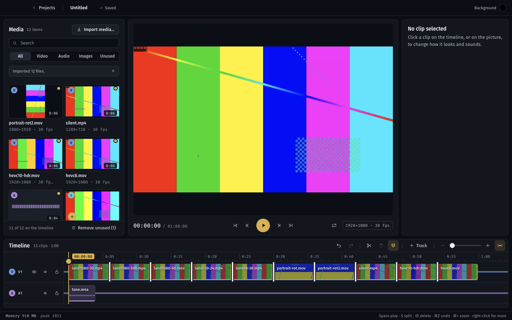
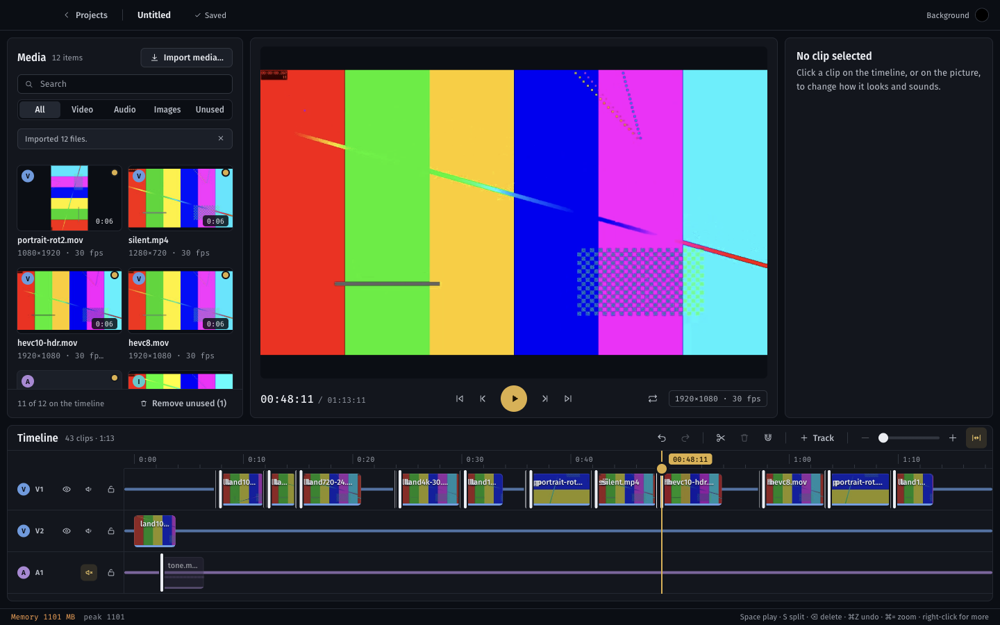
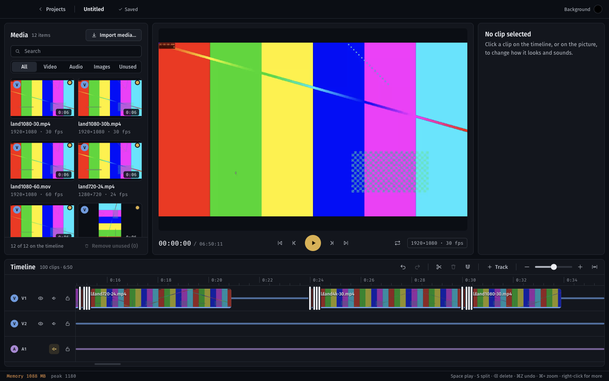

# M4 verification report

Generated 2026-11-11 23:38 by `scripts/verify/verify.py M4`.
Commit `3f9cc33` (uncommitted changes present) · macOS-27.0.1-arm64-arm-64bit · 24GB RAM. The 8GB target Mac is a separate run; memory figures from other machines are indicative only.

**Result: 55/55 checks passed.**

## Static checks

| Check | Result | Detail |
|---|---|---|
| pnpm typecheck | pass | 0s |
| pnpm lint | pass | 0s |
| pnpm test (schema, store, import, crash) | pass | 0s |

## End-to-end checks (real Electron app, driven over CDP)

| Check | Result | Evidence |
|---|---|---|
| Ten clips, music and a still imported with proxies | pass |  |
| All ten clips on V1 back to back, music on A1 | pass |  |
| Adding clips is undoable (one step per clip) | pass | {'size': 11, 'canUndo': True, 'canRedo': False} |
| Filmstrip drawn on video clips (many colours across the clip body) | pass | {'colors': 68, 'purple': 109, 'px': 2205} |
| Waveform drawn on the audio clip (audio-line pixels in the wave band) | pass | {'colors': 7, 'purple': 68, 'px': 1407} |
| Cmd+= zooms in (3 steps of 1.5x) | pass | {'x': 10, 'y': 672, 'w': 1420, 'ppf': 2.161556603773585, 'sx': 0, 'lane': 168, 'pad': 14, 'rendered': 5, 'sy': 0} |
| Zoomed in, only clips in view are rendered (virtualised) | pass | 5 rendered, 5 clip blocks in the DOM of 11 |
| Horizontal wheel scrolls the timeline | pass | scrollX 0 to 2400 |
| Shift+Z fits the whole edit again | pass |  |
| Dragging a clip's end handle trims its end | pass | 180 to 118 frames (expected about 118) |
| Trim keeps source duration in step with frames | pass |  |
| Dragging a clip's start handle trims its start (start and source move together) | pass | start +47 frames, source in 1566667us |
| A trim stops at the start of the source | pass | 180 |
| A start trim can be dragged all the way back to the start of the source | pass | 0 |
| Cmd+Z undoes the last trim | pass |  |
| S splits the selected clip at the playhead | pass | head 360+88, tail at 448, playhead 448 |
| The tail continues the source where the head ends | pass |  |
| Backspace deletes the selected clip and leaves a gap | pass |  |
| Dragging a clip near an edge snaps it flush, with a snap guide while dragging | pass | start 448, gap at 448, guide 1 |
| Dropping a clip onto another slides it to the nearest free place (here, straight after it), never overlapping | pass | dropped at about 1745, landed at 1800, last clip ends at 1800 |
| Cmd-click adds a clip to the selection; the inspector shows the count | pass |  |
| Dragging one of a selection moves the whole selection by the same amount | pass | [1620, 1800] to [1723, 1903] |
| Right-click opens the clip menu; Duplicate adds a copy | pass |  |
| The copy is selected and placed without overlapping | pass |  |
| Cmd+D duplicates too | pass |  |
| + Track adds a video track on top | pass |  |
| Dragging a clip up moves it to the new video track | pass | 98f5995c-e24e-4d13-b6a9-0018b51e1d7b |
| An audio clip dragged onto a video track moves in time but stays on its audio track | pass | start 0 to 76 |
| Eye button hides a video track | pass |  |
| Speaker button mutes a track | pass |  |
| A locked track's clips cannot be moved or deleted, and the refusal is explained | pass |  |
| Track menu: Move down reorders tracks | pass |  |
| Track menu: Delete track removes it and its clips | pass |  |
| Undo brings the deleted track back with its clip | pass |  |
| Clicking the picture selects the top clip under the playhead and outlines it | pass | selected ['7848e0df-509e-4715-af65-0c18679a242b'], top 7848e0df-509e-4715-af65-0c18679a242b |
| Dragging the picture positions the clip (in project pixels) | pass | x 263 y 132 (expected 263, 132) |
| A whole canvas drag is one undo step | pass | 29 to 30 |
| Undo puts the picture back | pass |  |
| Inspector slider drag changes the clip and is one undo step | pass | opacity 0.39, steps 30 to 31 |
| Rough cut made by hand: at least 50 edits recorded since the ten clips were added | pass | 20 rough-cut edits then 30 keyboard splits |
| Exit: 50 undo steps return the project to exactly where the rough cut started | pass | 0.3s |
| Exit: 50 redo steps return it exactly to the finished cut | pass |  |
| The cut is saved to project.json | pass |  |
| Reopen: the cut is restored exactly; undo history starts fresh | pass |  |
| Exit: timeline scrolls at 60fps with 100 clips (each frame re-renders the lanes and repaints the canvases) | pass | 120.0fps average, p95 frame 10.2ms, worst 10.4ms over 239 frames |
| Filmstrips that scroll out of view are evicted (at most 4 hidden ones kept) | pass | {'frames': 239, 'avg': 8.332635983263598, 'p95': 10.200000000004366, 'max': 10.400000000001455, 'maxRendered': 18, 'hiddenImagesHeld': 4} |
| All 100 clips in view (zoomed to fit): repaints still hold 60fps | pass | 116.6fps, p95 10.3ms, 100 clips rendered |
| Virtualised: the DOM holds exactly the clips in view, not all 100 | pass | 13 clip elements for 13 clips in view of 100; at most 18 while scrolling |
| Memory bar: editor tab under 600MB (indicative on this machine) | pass | 463MB; by phase {'ten clips on the timeline': {'total_mb': 910, 'tab_mb': 294}, 'after trims, splits, moves, tracks': {'total_mb': 944, 'tab_mb': 321}, 'after previewing on the canvas': {'total_mb': 949, 'tab_mb': 329}, 'after 50 undos and 50 redos': {'total_mb': 1099, 'tab_mb': 463}, 'reopened, 100 |
| Memory bar: total under 1.2GB (indicative on this machine) | pass | 1107MB |
| No uncaught errors in the page | pass | [] |
| No errors in the app log | pass | [] |

## Measurements

- machine ram gb: 24
- screenshots: ['M4-timeline.png', 'M4-rough-cut.png', 'M4-100-clips.png']
- scroll 100 clips: {'frames': 239, 'avg': 8.33, 'p95': 10.2, 'max': 10.4, 'maxRendered': 18, 'hiddenImagesHeld': 4}
- repaint 100 clips fit: {'frames': 239, 'avg': 8.58, 'p95': 10.3, 'max': 18.3, 'maxRendered': 100, 'hiddenImagesHeld': 0}
- memory by phase: {'ten clips on the timeline': {'total_mb': 910, 'tab_mb': 294}, 'after trims, splits, moves, tracks': {'total_mb': 944, 'tab_mb': 321}, 'after previewing on the canvas': {'total_mb': 949, 'tab_mb': 329}, 'after 50 undos and 50 redos': {'total_mb': 1099, 'tab_mb': 463}, 'reopened, 100 clips': {'total_mb': 1107, 'tab_mb': 461}, 'after scrolling 100 clips': {'total_mb': 1088, 'tab_mb': 458}}
- memory peak total mb: 1107
- memory first total mb: 910
- memory peak single tab mb: 463
- memory samples: 7

## Artifacts

- `workdir /var/folders/yq/6trmhvwn3y1cngnbq6gh2mjh0000gn/T/studio-m4-nm8u839d`

## Decisions and findings

- **New package `packages/editor-core`** (pure TypeScript, depends only on `@studio/schema` and immer). Every timeline edit is a typed command (`addAsset`, `moveClips`, `trimClip`, `splitClips`, `deleteClips`, `duplicateClips`, `updateClip`, `addTrack`, `deleteTrack`, `moveTrack`, `setTrack`, `setProject`) applied with `produceWithPatches`. Commands are plain data and never create ids, so a command replays to the same result, and an agent could call the same shapes as tools later. 34 unit tests, including 50 random edits that undo to the exact starting project and redo to the exact end.
- **Rules the commands enforce:** clips on one track never overlap; a clip on a locked track cannot change and nothing moves onto a locked track; video and stills go on video tracks, audio on audio tracks; trims stop at one frame, at the neighbours, at frame 0 and at the ends of the source (stills have no source limit). A failed command changes nothing and returns a sentence the status bar shows ("That track is locked").
- **Dropping a clip onto another slides it to the nearest legal place** (`resolveMove`): the asked position if free, otherwise the nearest position that butts it against a neighbour. There is no overwrite or ripple mode.
- **Split** keeps the asset, speed and transform on both halves; the source offset of the tail comes from the split frame. The fade in stays with the head and the fade out and any `transitionOut` move to the tail, so the cut is hard on both sides.
- **Undo** stores inverse patches only, capped at 200 steps. A slider drag in the inspector is one step (same field within a second); a drag on the canvas is one step however slow (a per-gesture key). History starts empty on every open, and is cleared when unused media is removed, because undo could otherwise bring back a clip whose file was just deleted. Asset-manifest edits (import, metadata, proxies, relink) are not undo steps, and `update()` now throws if a recipe touches anything but `assets`, because the recorded patches address tracks by position.
- **Timeline performance:** rows and clips are virtualised (only what intersects the viewport is rendered; four rows show, more scroll), clip bodies with filmstrips and waveforms are painted on one canvas per visible row, and zoom and scroll are the timeline's own state so canvas and DOM move in the same frame. Filmstrip sprites (about 3.5MB decoded each) are loaded for visible clips only and evicted once out of view, keeping at most four hidden ones.
- **Canvas:** clicking the picture selects the top visible clip under the playhead; dragging it sets `transform.x/y` in project pixels. The gold box follows fit, scale and rotation with the same maths as the composition.
- **Keyboard:** S or Cmd+B split, Delete or Backspace delete, Cmd+D duplicate, Cmd+A select all, Cmd+Z and Shift+Cmd+Z (or Cmd+Y) undo and redo, Cmd+= and Cmd+- zoom (pinch or Cmd+wheel zooms around the pointer), Shift+Z fit, N snapping, Esc deselect. Shift or Cmd click adds to the selection. A focused slider keeps its arrow keys; every other shortcut still works.
- **Finding (memory):** the timeline and the undo history add nothing measurable: 50 edits plus 100 undo and redo steps left the editor tab at 262MB (324MB before; it fell). What moves the tab is seeking across many clips, which fills Remotion's decoded-frame cache (capped at 240MB since M3): 30 seeks across ten 1080p clips took it from 262MB to 569MB, settling at 490MB. That is close to the 600MB editor bar on this 24GB machine, so measure scrubbing across a whole real vlog on the 8GB Mac; if it crosses the bar there, the lever is the cache size, not the timeline. The run's per-phase figures are under Measurements.
- **Finding:** filmstrip sprites loaded from `media://` taint the canvas unless the image is requested with `crossOrigin = "anonymous"` (the scheme is CORS-enabled, so this is all it takes). The tests read the canvas pixels to prove the filmstrips and waveforms are drawn.
- **Finding (test harness):** `visual.py` parks the pointer before every capture; for a shot taken mid-drag that dragged the clip eight seconds across. `shot(..., park=False)` now skips it. The recovery shot also copies the final `project.json` over `.prev` first, since the new track toggles made "the save before last" depend on timing.

## Independent review (Opus)

An independent review of the uncommitted change found three confirmed bugs, all fixed with a failing test first:
- A start trim could not always be dragged back: after a trim, source offsets carry sub-microsecond rounding, and `clampTrim` floored them, losing a frame (at 30fps, trims of 1, 4, 7 or 10 frames). Now rounded. A new e2e step drags a start trim all the way back.
- Dragging an end handle outward could shorten a clip whose rounded duration already ran up to half a frame past its source. The source limit now only stops an extension.
- A command with a repeated clip id (`moveClips` to another track) deleted an unrelated clip. Ids are de-duplicated in `applyCommand`.

Also fixed from the review: a drag now commits the command recomputed from the final pointer position (not the last rendered preview); undo and redo are ignored mid-drag, and a clip that disappears mid-drag ends the gesture instead of throwing; a trim handle trims its own clip even inside a multi-selection; a selection that includes a locked clip does not move (matching the menu); adding media skips a locked track for the next unlocked one, or makes a new track; split on a locked clip says the track is locked; Ctrl-click on a Mac is the context menu only, not also a selection toggle; Cmd+Z in the project-name field undoes through the history; a failed peaks read or filmstrip load retries; `update()` now refuses any change outside `assets`. Weak e2e checks were tightened (a drop must actually land at the resolved place, the duplicate is checked for overlap, the audio-onto-video drag must still move in time), and a new vitest runs 3 x 120 random edits across tracks, asserting no overlap after every step. Not changed: the scroll benchmark drives the view state directly, so the wheel handler itself is not timed, and canvas hit-testing is exercised only on an unrotated clip (the maths was checked by hand against the composition).

## Visual baselines

Updated on purpose for the new timeline (it gained a toolbar, wider track headers with hide, mute and lock, and a 10px scrollbar row, which moves every editor shot up by 10px): `editor-empty`, `editor-media`, `media-tile-hover`, `media-tile-selected`, `media-notice`, `media-filter-audio`, `media-no-match`, `editor-timeline-start`, `editor-timeline-portrait`, `editor-clip-selected`, `inspector` (new Timing section), `transport-loop-on`, `sequence-strip`, `sequence-interchange`, `media-missing`, `editor-vertical-empty`, `editor-recovered`. New: `timeline-clip-menu`, `timeline-multi-select`, `timeline-track-menu`, `timeline-track-states`, `timeline-zoomed`, `timeline-snap-guide`, `canvas-selected`. 29 of 29 pass on a second run against the new baselines.

## Not built, and known limits

- Rubber-band (marquee) selection is not built; multi-select is Shift or Cmd click and Cmd+A.
- A selection spread over several tracks keeps its tracks when dragged; only clips from one track can change track together.
- No auto-scroll while dragging a clip to the edge of the lane: zoom out, or scroll first.
- Inspector timing (start, length, source in) is read-only; change it by trimming on the timeline.
- Markers are drawn on the ruler and snapped to, but cannot be added until M5 (Markers is an M5 item).
- Dragging media from the panel onto the timeline (dnd-kit in the plan's stack) is not part of the M4 list and is not built; the + button and double-click still append.
- Trackpad pinch zoom arrives as a Ctrl+wheel event and is handled, but the test drives zoom with Cmd+= only.
- The 60fps and memory figures come from the 24GB dev Mac with a 120Hz display. Repeat the 100-clip scroll and the rough cut on the 8GB Mac with real footage before calling the exit met there.
