# M5 verification report

Generated 2026-11-12 03:18 by `scripts/verify/verify.py M5`.
Commit `cc9d860` (uncommitted changes present) · macOS-27.0.1-arm64-arm-64bit · 24GB RAM. The 8GB target Mac is a separate run; memory figures from other machines are indicative only.

**Result: 78/78 checks passed.**

## Static checks

| Check | Result | Detail |
|---|---|---|
| pnpm typecheck | pass | 1s |
| pnpm lint | pass | 1s |
| pnpm test (schema, store, import, crash) | pass | 1s |

## End-to-end checks (real Electron app, driven over CDP)

| Check | Result | Evidence |
|---|---|---|
| Four clips, music and a still imported with proxies | pass |  |
| M adds a marker at the playhead | pass | [{'id': '189d774a-5714-4579-bf5f-d98c64db53d9', 'frame': 45, 'label': ''}] |
| A second marker at the same frame is refused with a reason | pass |  |
| Double-clicking a marker names it | pass |  |
| Dragging a marker moves it and it snaps to a cut | pass | 180 vs cut at 180 |
| Clicking a marker moves the playhead to it | pass | 180 |
| Escape in the name field keeps the old name | pass |  |
| Delete marker from its menu | pass |  |
| Marker delete, move, rename and add each undo in turn | pass | [[(180, 'Hook')], [(45, 'Hook')], [(45, '')], []] |
| Crop mode shows the whole picture with a crop rectangle | pass | {'x': 375, 'y': 130.6875, 'width': 730, 'height': 410.625} |
| Dragging the left crop handle cuts the left quarter (one undo step) | pass | {'x': 0.25, 'y': 0, 'width': 0.75, 'height': 1}, steps 5 to 6 |
| Dragging a corner moves two edges | pass | {'x': 0.25, 'y': 0.1, 'width': 0.5, 'height': 0.9} |
| Dragging inside the rectangle moves the crop and stops at the edge of the picture | pass | {'x': 0, 'y': 0.1, 'width': 0.5, 'height': 0.9} |
| After cropping, the picture box has the kept part's shape | pass | 0.988 vs 0.988 |
| The preview draws the crop (picture changed) | pass |  |
| Typing a cut for the right edge in the inspector crops it | pass | {'x': 0, 'y': 0.1, 'width': 0.9, 'height': 0.9} |
| Reset crop shows the whole picture | pass |  |
| Undo brings the crop back | pass |  |
| Rotation from the inspector turns the clip and its box | pass | (90, 'left: 0px; top: 0px; width: 730px; height: 410.625px; transform: rotate(90deg);') |
| Mirrored flips the picture | pass |  |
| Normal puts it back, pixel for pixel | pass |  |
| Detach audio puts the clip's sound on an audio track at the same time and source, and mutes the video | pass | track audio, start 180 vs 180, video muted True |
| The sound goes on the first audio track with room (A1, free there) | pass | ['video', 'audio'] |
| Detach is one undo step | pass |  |
| The detached clip shows as sound in the inspector (no Picture section) | pass |  |
| The detached clip draws a waveform (as many wave pixels as the music clip, within half) | pass | 560 wave pixels, music clip 364 |
| Dragged up onto the video track, the sound stays on an audio track and moves in time | pass | audio, start 180 to 210 |
| The clip's sound button mutes it | pass |  |
| Fade in and out set in seconds land as frames | pass | (15, 30) |
| Undoing the fades, mute, move and detach removes the sound clip and unmutes the video | pass |  |
| Dragging the speed slider to 2x halves the clip and keeps its source | pass | speed 2, 180 to 90 frames |
| The next clip on the track ripples in by the same amount | pass | 540 to 450 |
| Clips on other tracks do not move | pass |  |
| A whole slider drag is one undo step | pass | 12 to 13 |
| The timeline labels the clip 2× | pass |  |
| At 2x the preview shows source frame 40 at clip frame 20 | pass | mean difference to 1x frame 40: 0.00, to 1x frame 20: 3.82 |
| Undo restores the speed and the following clip | pass |  |
| T adds a 3-second title at the playhead on a new text track on top, selected | pass | ('text', 30, 90) |
| The text track is tagged T1 and the clip shows its words | pass |  |
| Typing in the inspector changes the title | pass |  |
| Size, colour, box, outline, shadow and alignment are set from the inspector | pass | {'content': 'নমস্কার\nWelcome back', 'fontFamily': 'Noto Sans Bengali', 'fontSize': 110, 'color': '#ffd34d', 'alignment': 'left', 'lineHeight': 1.2, 'background': '#000000', 'stroke': {'color': '#000000', 'width': 3}, 'shadow': {'color': 'rgba(0,0,0,0.6)', 'blur': 12, 'x': 0, 'y': 4}} |
| The preview draws the title with that style | pass | {'font': '"Noto Sans Bengali"', 'size': '110px', 'color': 'rgb(255, 211, 77)', 'bg': 'rgb(0, 0, 0)', 'stroke': '3px', 'shadow': 'rgba(0, 0, 0, 0.6) 0px 4px 12px', 'align': 'left'} |
| Bengali is shaped with the bundled Noto Sans Bengali | pass | "Noto Sans Bengali" |
| Changing the font to Bebas Neue | pass |  |
| The inspector's title controls fit its width (no sideways overflow) | pass | 0px |
| Enter and exit animations are set | pass |  |
| Typewriter: early in the title only the first letters show, whole graphemes, the rest held in place hidden | pass | {'shown': 'নমস্কা', 'hidden': 'র\nWelcome back'} |
| By the middle of the title everything is typed | pass |  |
| Fade out: the title fades near its end | pass | (1.0, 0.0909091) |
| Clicking the title on the picture selects it and outlines it | pass |  |
| The outline matches the drawn title | pass | ({'x': 580.8828125, 'y': 248.203125, 'width': 318.234375, 'height': 115.578125}, {'x': 580.9481811523438, 'y': 248.2855682373047, 'width': 318.10369873046875, 'height': 115.42887878417969}) |
| Dragging the title on the picture moves it (lower third) | pass | y 316 (expected 316) |
| The outline follows the moved title | pass | (248.203125, 368.3515625) |
| Cmd+Z in the text field undoes through the history | pass | নমস্কার Welcome back |
| Setup: A and B touch, with 20 frames of untrimmed footage each side of the cut | pass |  |
| At a cut with no spare footage the transition buttons are off and the inspector says why | pass |  |
| Dissolve from the inspector adds a half-second transition into the next clip (one undo step) | pass | {'kind': 'fade', 'durationInFrames': 15} |
| The timeline draws the transition centred on the cut | pass | {'x': 452.3828125, 'y': 756.5, 'width': 25.4296875, 'height': 16} |
| Inside the dissolve the preview blends the two clips (differs from A alone) | pass | difference to A alone 3.87 |
| After the transition the picture is B as before | pass | 0.00 |
| Wipe, lengthened to the most the handles allow (40 frames) | pass | {'kind': 'wipe', 'durationInFrames': 40} |
| The length stops at what the footage allows | pass |  |
| Slide | pass |  |
| Pulling the clips apart removes the transition | pass |  |
| Undo brings it back with the clips | pass |  |
| Exit: the vlog has four clips with a dissolve and a slide, two titles with animations, music with a fade out, and markers | pass | {'transitions': ['fade', 'slide'], 'titles': 2, 'markers': 1} |
| Exit: the vlog is saved to project.json (schema-valid, every new field included) | pass |  |
| Exit: reopening restores the vlog exactly | pass |  |
| Exit: after reopening the preview draws the same frames (mid-dissolve, a title, a plain frame) | pass | [0.0, 0.0, 0.0] |
| Exit: the whole vlog plays to the end in real time | pass | reached frame 649 of 650 (polled every 0.5s), stopped after 22.5s for 21.7s of video |
| Playback that reaches the end rests on the last frame (not back on frame 0) | pass | playhead at 649, last frame 649 |
| Memory while playing the vlog: editor tab under 600MB (indicative on this machine) | pass | {'total': 809, 'tab': 416} |
| Memory while playing the vlog: total under 1.2GB (indicative on this machine) | pass | {'total': 809, 'tab': 416} |
| No uncaught errors in the page | pass | [] |
| No errors in the app log | pass | [] |

## Measurements

- machine ram gb: 24
- screenshots: ['M5-marker.png', 'M5-crop-mode.png', 'M5-picture-rotated.png', 'M5-detached-audio.png', 'M5-speed.png', 'M5-title.png', 'M5-title-placed.png', 'M5-transition-dissolve.png', 'M5-transition-wipe.png', 'M5-transition-slide.png', 'M5-vlog.png']
- playback peak mb: {'total': 809, 'tab': 416}

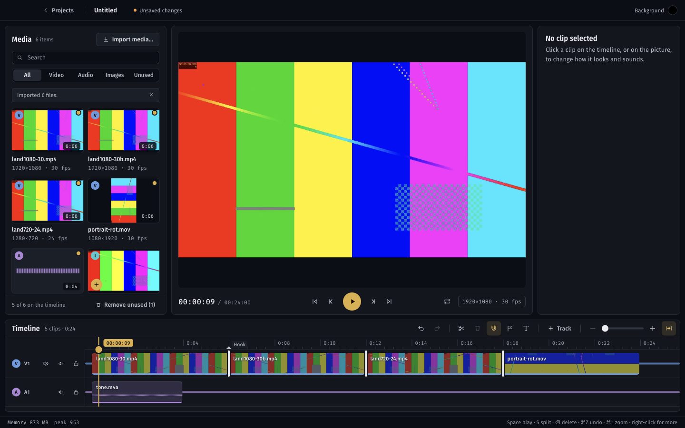

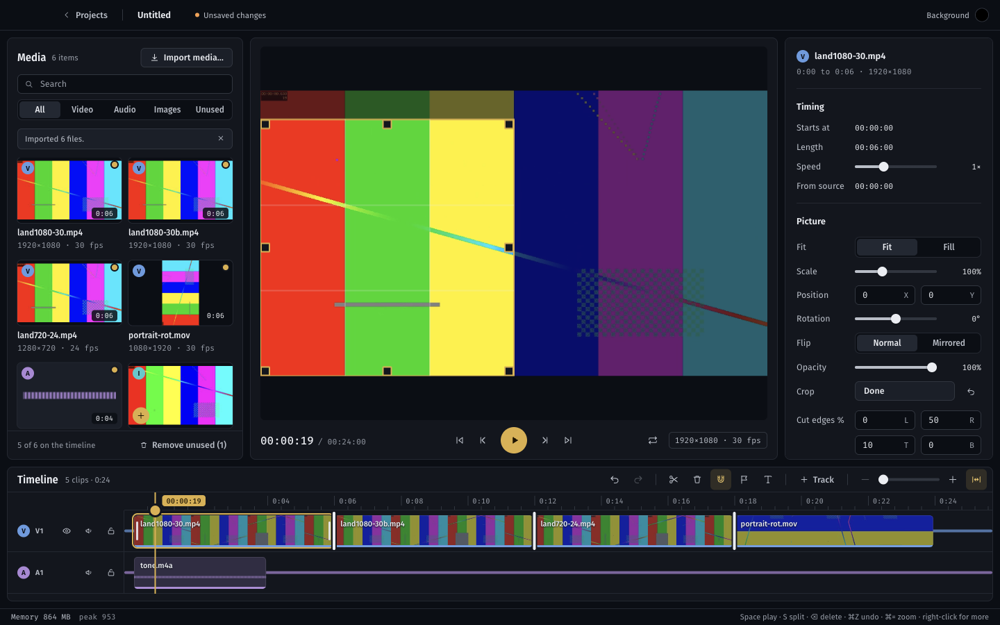

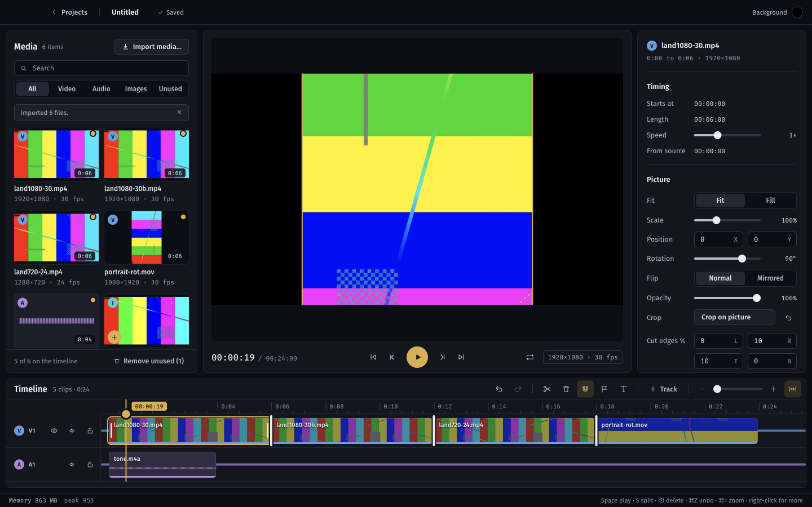

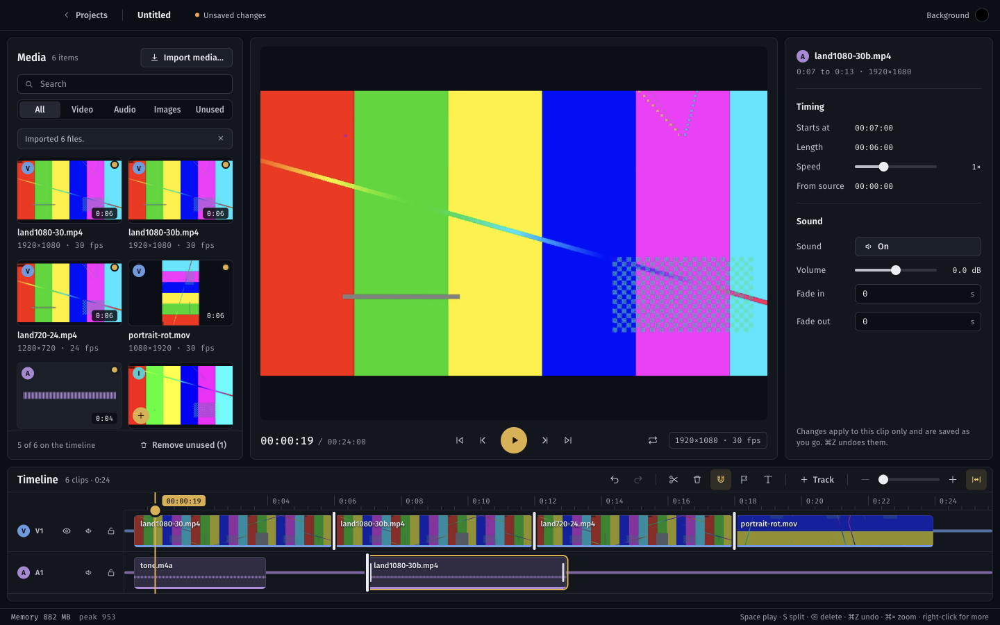

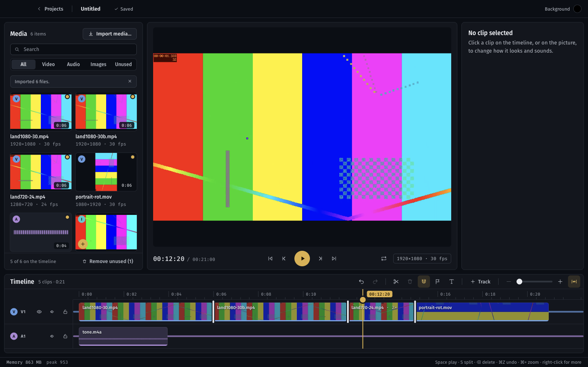

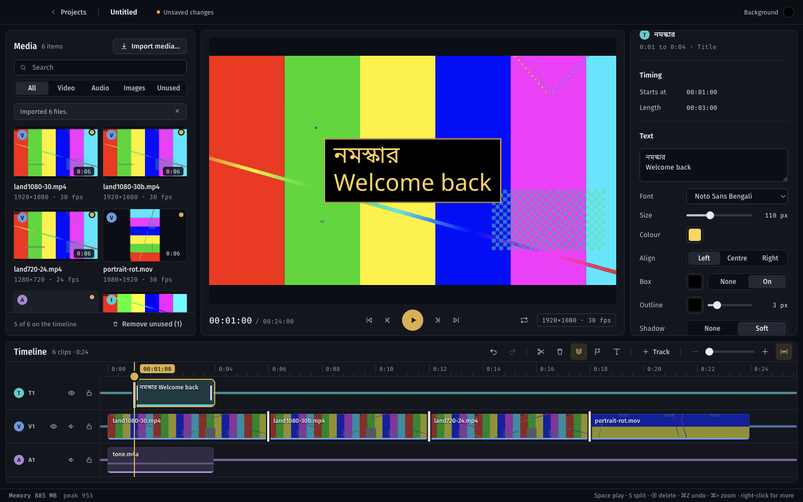

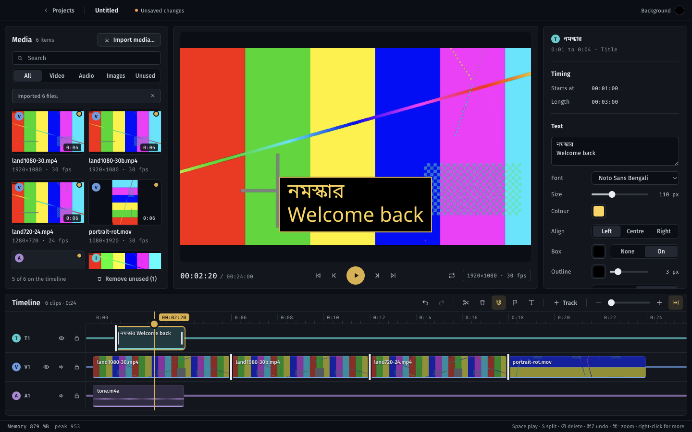

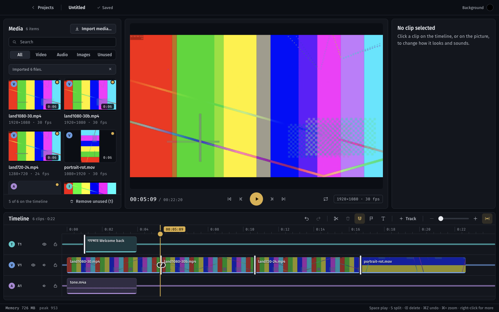

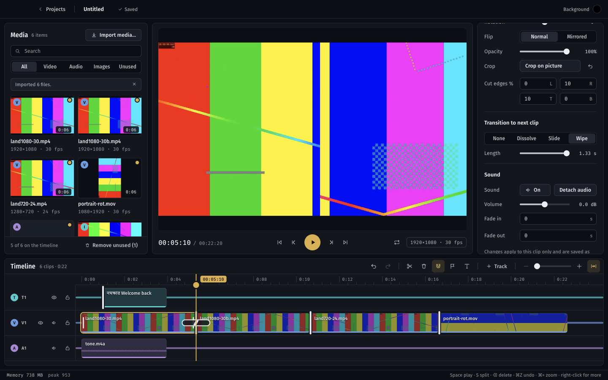

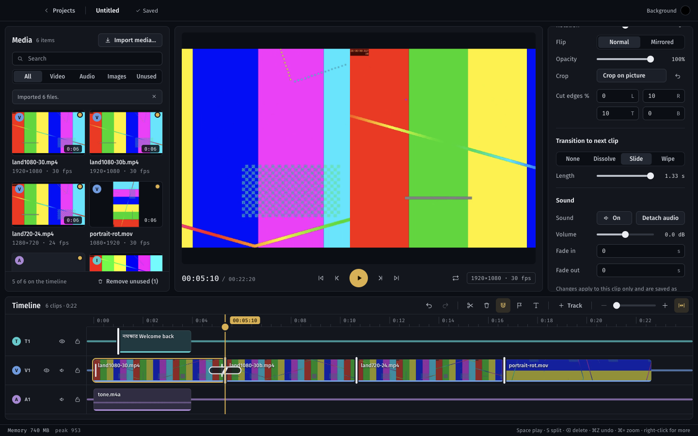

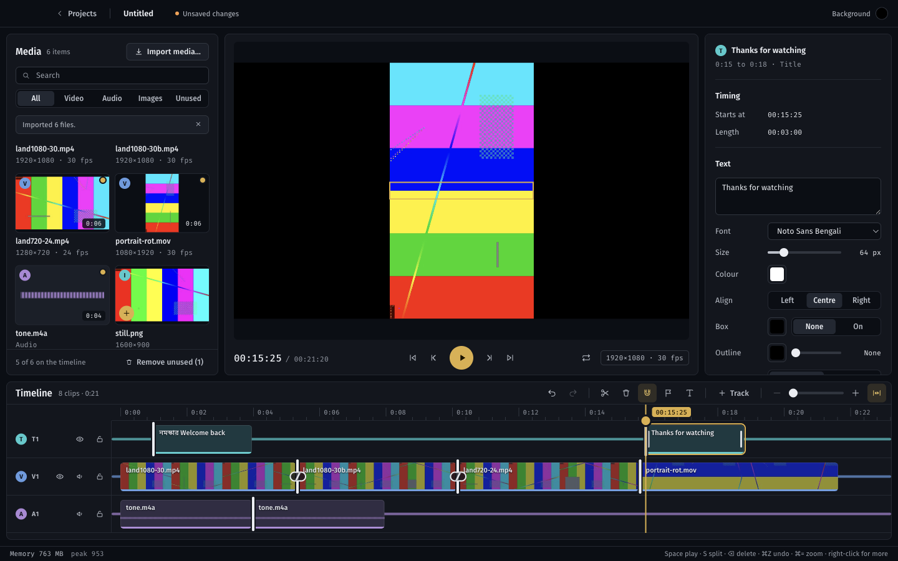

## Artifacts

- `workdir /var/folders/yq/6trmhvwn3y1cngnbq6gh2mjh0000gn/T/studio-m5-94nid9mr`

## Decisions and findings

Choices made with the user before building (Nov 12): transitions are centred on the cut (clip positions never move), all three schema kinds are built (fade, slide, wipe), crop is set both in the inspector and with handles on the picture, and titles get none, fade, slide up, pop and typewriter. Schema v1 is unchanged: every field M5 uses was already in it; crop units and preset names are checked by the commands instead of tightening v1 in place.

- **New commands** in `packages/editor-core`: `addMarker`, `updateMarker`, `deleteMarker`, `setSpeed`, `detachAudio`, `addText`, `updateText`, `setTransition`; `updateClip` now takes `crop` (null clears it). 61 unit tests (27 new), and the random-edit test now also changes speed and transitions, asserting after every step that no clips overlap and every transition fits its cut.
- **Markers:** M or the flag button adds one at the playhead (a second one on the same frame is refused). On the ruler: click to jump, drag to move (snaps), double-click to name, right-click to rename or delete.
- **Picture:** crop is stored as fractions of the displayed source (after rotation), so the 720p proxy and the original crop alike; at least 5% is kept per side; a crop of the whole picture is stored as no crop. One pure function, `pictureLayout` in `@studio/schema`, places a cropped clip for both the composition and the canvas box. Crop mode draws the clip whole and untransformed so every handle can reach the source edges; handles sit inside the rectangle so a full-frame crop keeps them on screen. Rotation (-180 to 180) and Mirrored flip are in the inspector.
- **Audio:** per-clip mute button; Detach audio puts an audio clip that references the video asset on the first audio track with room (or a new one at the bottom) and mutes the video clip. A clip's kind now follows its track (`clipKind`): on an audio track it is sound, draws a waveform, plays through `<Audio>` and can only move between audio tracks.
- **Speed** 0.5x to 2x: the clip keeps the same stretch of source and changes length; later clips on the same track move by the difference, gaps kept; other tracks never move. `sourceDurationUs` is left as it is, so a slider dragged back and forth returns the exact clip (tested over 8 steps). The timeline labels a clip that is not 1x ("· 2×").
- **Titles** live on text tracks (tag T, cyan, as DESIGN.md reserved): T or the toolbar button adds a 3-second title at the playhead, on a free text track or a new one on top. Content, font (the two bundled fonts; a family not bundled shows as "not installed"), size, colour, alignment, box, outline, shadow, enter and exit. Animation is pure maths in `@studio/schema` (`textAnimation`): 0.4s for fade, slide up and pop; typewriter types 18 graphemes a second, done by half the clip, splitting text with `Intl.Segmenter` so Bengali conjuncts (ক্ষ, ত্র) never break; the untyped rest stays in the layout, hidden, so lines do not move. A Latin-only font falls back to Noto Sans Bengali for Bengali letters. Titles are selected and dragged on the picture; their box is measured from the drawn text.
- **Transitions** are centred on the cut: the outgoing clip plays ceil(d/2) frames past it and the incoming one starts floor(d/2) early, each on untrimmed source. `transitionRoom` gives the longest a cut can take: twice the outgoing clip's handle, twice the incoming one's plus one, neither clip's length, and 2 seconds. When no transition fits, the inspector says why ("Not enough footage past the cut…"). After any edit a transition that no longer fits shrinks to what does or goes, inside the same command, so undo brings it back. Fade is a dissolve (the incoming clip fades in over the outgoing one), slide pushes the outgoing clip out to the left, wipe reveals the incoming clip from the left; sound crossfades across the window. Every look is opacity, transform or `clip-path: inset()`, all handled by the web renderer (checked in its source; an actual export is M6's golden-frame test); stroke, `paint-order` and `text-shadow` for titles likewise.
- **Finding (dev setup, fixed):** Vite serves the workspace packages' source under `/node_modules/...?v=<hash>` with `Cache-Control: immutable`, and the hash only changes with dependencies, so Electron's on-disk HTTP cache kept running the old `editor-core` after an edit (new commands silently did nothing in `pnpm dev` and in the e2e runs). `main.ts` now turns the HTTP cache off when not packaged.
- **Finding (pointer capture):** with the timeline's pointer capture, Chrome sends `dblclick` to the capturing panel, not the marker, so marker double-clicks are counted in the gesture instead.
- **Finding (ResizeObserver):** swapping the canvas overlay's root element made the observer report the removed element's width of 0 and the preview scale became 0. Crop mode now renders inside the same root.
- **Finding (M3 bug, not fixed):** when playback reaches the end, the playhead jumps back to frame 0 instead of resting on the last frame. The Player calls `pause()` before `dispatchEnded()` (Remotion 4.0.542), so `playback.ts`'s `onEnded` sees `playing` already false and does nothing, and the Player's default `moveToBeginningWhenEnded` shows frame 0. M3's e2e never checked it. Likely fix: `moveToBeginningWhenEnded={false}` on the Player in `Stage.tsx`. The M5 exit check records the furthest frame reached instead.

## Measurements

From `docs/reports/M5.md` on the 24GB dev Mac (indicative only): playing the finished 21.7s vlog (four clips, a dissolve, a slide, two titles, music twice with a fade out) took 22.4s and peaked at 803MB total, 414MB for the editor tab. The 2x speed check matched the 1x picture exactly (mean difference 0.00, against 3.82 for the wrong frame); mid-dissolve differed from either clip alone by 3.87.

## Visual baselines

Updated on purpose: the timeline toolbar gained Add marker and Add title, which shifts the toolbar in `editor-empty`, `editor-media`, `editor-timeline-start`, `editor-timeline-portrait`, `sequence-strip`, `sequence-interchange`, `timeline-multi-select`, `timeline-track-menu`, `timeline-track-states`, `timeline-zoomed`, `timeline-snap-guide`, `editor-vertical-empty`, `editor-recovered`; the inspector gained Speed, Rotation, Flip and Crop in `inspector`, `editor-clip-selected`, `canvas-selected`; the clip menu gained Detach audio in `timeline-clip-menu`. New: `title-selected`, `inspector-title`, `timeline-m5`, `canvas-crop`. 33 of 33 pass on a second run.

## Not built, and known limits

- Speed changes pitch: `@remotion/media` plays sound at the clip's rate without pitch correction (not checked by ear).
- Sound in general (the crossfade, detach, mute) is checked through the project and the composition's volume, not by listening.
- Slide and wipe run one way only (right to left, left to right): the schema has no direction field.
- Picture fades (fade from black at a clip's own edge) are not built; fades in and out are sound only, and a transition covers a cut between clips.
- A detached sound clip is not linked to its video: moving or trimming one leaves the other.
- Detaching a clip whose sound is already detached makes a second sound clip.
- Only the two bundled fonts are offered.
- The Picture section grew, so at a 900px window the Sound section is below the fold of the inspector and needs a scroll.
- Not repeated on the 8GB Mac yet: the exit vlog with real footage and the memory bars.
