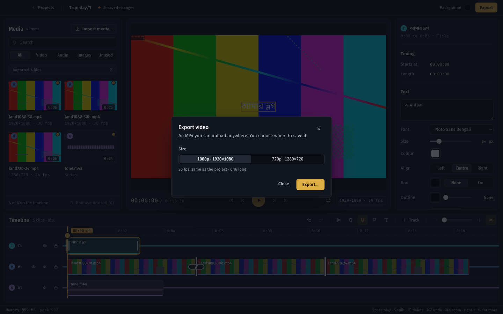
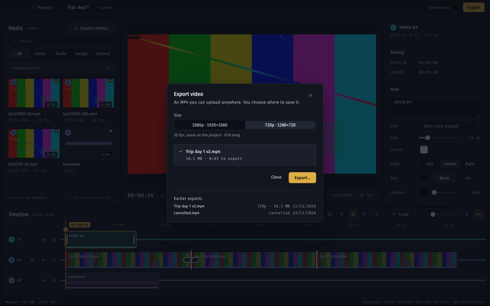
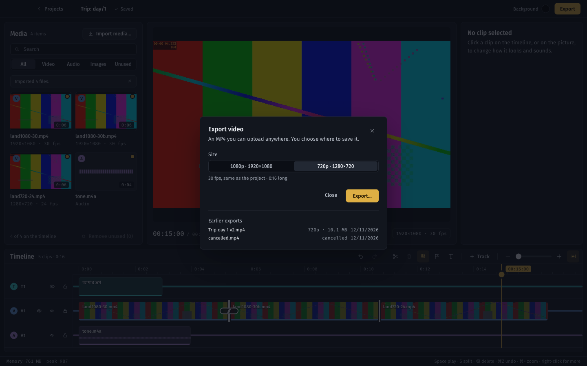

# M6 verification report

Generated 2026-11-12 16:32 by `scripts/verify/verify.py M6`.
Commit `906f4a2` (uncommitted changes present) · macOS-27.0.1-arm64-arm-64bit · ?GB RAM. The 8GB target Mac is a separate run; memory figures from other machines are indicative only.

**Result: 34/34 checks passed.**

## Static checks

| Check | Result | Detail |
|---|---|---|
| pnpm typecheck | pass | 1s |
| pnpm lint | pass | 1s |
| pnpm test (schema, store, import, crash) | pass | 1s |

## End-to-end checks (real Electron app, driven over CDP)

| Check | Result | Evidence |
|---|---|---|
| Export is disabled while the timeline is empty | pass |  |
| Three clips and music imported with proxies | pass |  |
| The vlog has a transition, a Bengali title and music | pass | 500 frames |
| The dialog offers 1080p and 720p with their pixel sizes | pass | ['1080p · 1920×1080', '720p · 1280×720'] |
| Cancelling the save dialog starts nothing | pass |  |
| The suggested name is the project name, made safe, plus a version | pass | Trip day 1 v1.mp4 |
| A destination inside Studio's project storage is refused | pass | Choose a folder outside Studio's project storage. |
| A folder that cannot be written gives a readable error and no export starts | pass | ENOENT: no such file or directory, open '/var/folders/yq/6trmhvwn3y1cngnbq6gh2mjh0000gn/T/studio-m6-tkgghpoo/out/no-such-folder/x.mp4.part' |
| Cancel stops the export and keeps no file (not even a partial one) | pass | cancelled, files [] |
| The render window is gone after a cancel | pass | 2 tabs vs 2 before |
| The export finishes | pass | done in 4.1s |
| Progress climbs steadily and a time estimate appears | pass | percents [0, 0, 6, 14, 22, 29]..[79, 87, 94], estimates ['Estimating time…', 'Estimating time…', 'About 0:08 left'] |
| The second export is version 2 (the cancelled one counted) | pass | Trip day 1 v2.mp4 |
| No .part file is left beside the export | pass |  |
| The MP4 is H.264 at 1280x720 and the project's frame rate | pass | h264 1280x720 30/1 |
| The MP4 has AAC audio | pass | aac |
| Video length matches the timeline | pass | 16.67s vs 16.67s |
| Audio and video end together (sync at the end of the file) | pass | video 16.67s, audio 16.70s |
| Golden frames: the export matches the preview at five frames (mean difference under 12 of 255) | pass | [5.65, 5.22, 5.25, 4.62, 4.84] |
| History in the project folder lists the cancelled and the finished export | pass | [{'id': '5bb97d4d-fc08-4f5d-a40a-a700b2bfdbfe', 'version': 1, 'fileName': 'cancelled.mp4', 'path': '/var/folders/yq/6trmhvwn3y1cngnbq6gh2mjh0000gn/T/studio-m6-tkgghpoo/out/cancelled.mp4', 'height': 1080, 'width': 1920, 'outputHeight': 1080, 'fps': 30, 'durationFrames': 500, 'sizeBytes': 0, 'startedA |
| Each export has a log file with its outcome | pass | ['1-12T11:01:58.425Z progress 12%\n2026-11-12T11:01:58.473Z cancel requested\n2026-11-12T11:01:58.535Z cancelled after 0.9s\n', "ct because it violates the document's Content Security Policy.\n2026-11-12T11:02:03.071Z done after 3.8s, 10104835 bytes\n"] |
| The dialog lists earlier exports | pass |  |
| Exporting did not change the project file (history is kept apart) | pass |  |
| A 1080p export finishes at 1920x1080 as version 3 | pass | done, 1920x1080, 4.2s |
| A source file that vanishes mid-render fails the export with a readable error | pass | failed: The export did not finish. Error fetching media://local/var/folders/yq/6trmhvwn3y1cngnbq6gh2mjh0000gn/T/studio-m6-tkgghpoo/projects/8e699ca4-e3ab-4ba2-bc28-4a332ec9310c/assets/3afc75a563560cb553bc1c58b4bd8b7f9cb95a55c3866150c10f1a5d03dcf665.mp4: 404 Not Found A log of this export is in the p |
| A failed export keeps no file (not even a partial one) | pass | ['Trip day 1 v2.mp4', 'Trip day 1 v3.mp4'] |
| The failed export is in history and its log, with the error | pass | {'status': 'failed', 'error': 'Error fetching media://local/var/folders/yq/6trmhvwn3y1cngnbq6gh2mjh0000gn/T/studio-m6-tkgghpoo/projects/8e699ca4-e3ab-4ba2-bc28-4a332ec9310c/assets/3afc75a563560cb553bc1c58b4bd8b7f9cb95a55c3866150c10'} |
| Memory during exports: total under 1.5GB (indicative on this machine) | pass | {'peak_total_mb': 987, 'first_total_mb': 812, 'peak_single_tab_mb': 258, 'samples': 47} |
| Thirty seconds after the export the render window is gone | pass | 1 tabs vs 2 before; total 517MB |
| No uncaught errors in the page | pass | [] |
| No errors in the app log | pass | [] |

## Measurements

- screenshots: ['M6-dialog.png', 'M6-done.png', 'M6-history.png']
- export 720p: {'seconds': 4.1, 'video_seconds': 16.7, 'realtime_factor': 0.24, 'mb': 10.1}
- golden frame diffs: [5.65, 5.22, 5.25, 4.62, 4.84]
- export 1080p: {'seconds': 4.2, 'realtime_factor': 0.25, 'mb': 18.6}
- total mb 30s after export: 517
- memory peak total mb: 987
- memory first total mb: 812
- memory peak single tab mb: 258
- memory samples: 47

## Artifacts

- `workdir /var/folders/yq/6trmhvwn3y1cngnbq6gh2mjh0000gn/T/studio-m6-tkgghpoo`

## Decisions and findings

Choices made with the user before building (Nov 11 to 12): export history lives in `<project>/exports.json`, not in `project.json`, so schema v1 is unchanged; the destination comes from a native save dialog in main, with a versioned suggested name (`<project> v<n>.mp4`); export runs at the project's own frame rate only (an fps picker was considered and dropped, because `convertProjectFps` rounds each clip start and length separately and would need a fix first); the `@remotion/renderer` fallback at concurrency 1 is not built, since spike 3 passed.

- **Flow:** the renderer says only which project and which size (`exports:start`, `{projectId, height}`). Main reads the project from disk (so the editor flushes its autosave first), checks that every original the timeline plays exists, asks for the destination, refuses anything inside the app's project storage, writes to `<file>.part` and renames on success. A hidden render window (`?worker=render`, `render-worker.ts`, `render-preload.ts`) runs `renderMediaOnWeb()` on `ProjectComposition` in `export` mode (originals, not proxies) and streams chunks to main. The window is destroyed after every export.
- **Size:** 1080p or 720p means the short side, so portrait and square projects scale correctly (`exportSize` in `@studio/schema`, even sizes). The render uses the web renderer's `scale` option. Bitrate is 10 Mbit/s at 1080p and 5 Mbit/s at 720p (`export-settings.ts`).
- **Progress, estimate, cancel:** progress is encoded frames over total, sent at most four times a second; the estimate is elapsed time scaled by the fraction left, shown after 2%. Cancel aborts the render, deletes the partial file and destroys the window; a renderer that ignores the abort is destroyed after 10 seconds. A render window silent for 120 seconds fails the export.
- **History and logs:** `exports.json` holds finished, failed and cancelled exports (oldest first; version numbers are never reused). Each export writes `<project>/exports/<id>.log` (settings, destination, progress every 10%, the render window's warnings and errors, the outcome). Both are written by `@studio/project-store` (`exports.ts`).
- **Golden frames:** `e2e_m6.py` compares the preview with the export at five frames, scaled to 160x90, with a mean difference under 12 of 255. The spike measured 40 dB PSNR for export against still.

## Not built, and known limits

- **Written without running anything.** The session that wrote M6 could not install dependencies (the proxy blocks `codeload.github.com`, which the `@electron/node-gyp` override needs), so none of it has been typechecked, linted, tested or run. First run: `pnpm typecheck && pnpm lint && pnpm test`, then `python3 scripts/verify/verify.py M6`, then `python3 scripts/verify/visual.py --update --only dialog-export` and review the other editor shots: the Export button in the header moves `editor-*`, `sequence-*`, `timeline-*`, `canvas-*`, `inspector*` and `title-*` shots that show the header.
- **Unchecked API names.** The Remotion docs were not reachable, so the `renderMediaOnWeb` options in `render-worker.ts` (`outputWritable`, `scale`, `onProgress({encodedFrames})`, `videoBitrate`) are from memory of the spike plan and need checking against `@remotion/web-renderer` 4.0.542. The call is cast to its parameter type so a wrong name shows up at run time, not as a type error; remove the cast once it compiles. `outputWritable` is given the same chunked writable the proxy encoder uses (Mediabunny `StreamTargetChunk`), which assumes the renderer forwards a Mediabunny target.
- The 5-minute 1080p30 export, audio sync at the 5-minute mark and the 1.5GB peak (Gate 2) are not automated: `e2e_m6.py` exports a short vlog and checks the audio and video end together. Run the long one by hand on the 8GB Mac with real footage.
- Leaving the project and coming back while an export runs loses the dialog's running state (the export carries on in main; a second start is refused with "An export is already running").
- Media proxy jobs are not paused during an export. If memory is tight on the 8GB Mac, pause the queue in `ExportService.start`.
- Disk-full and missing-disk handling beyond a readable error are M7.
