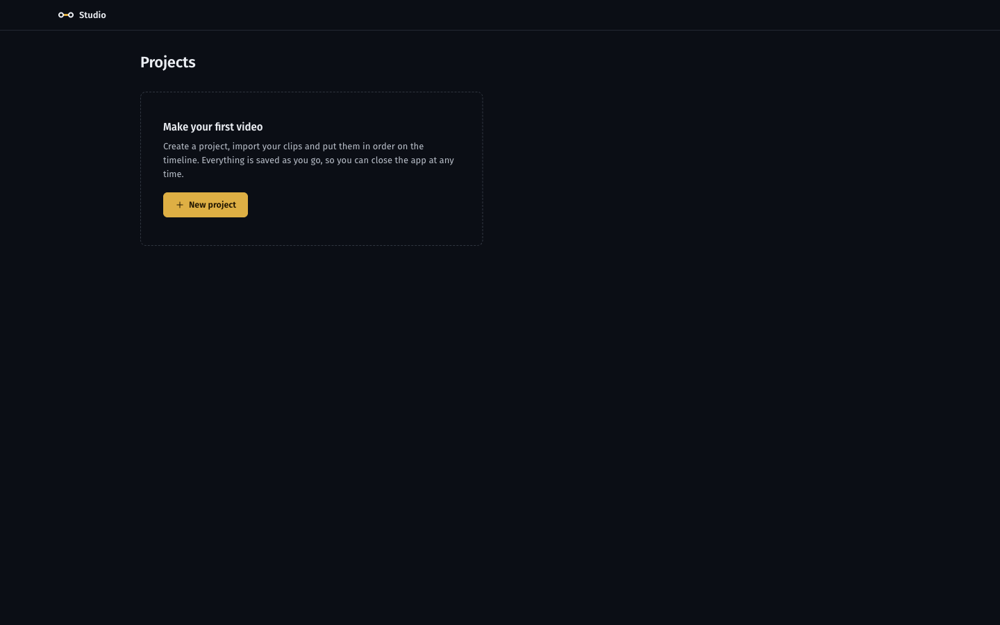
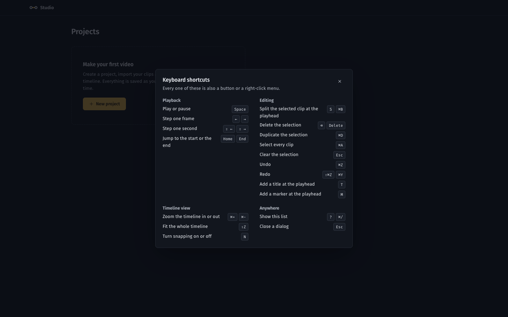
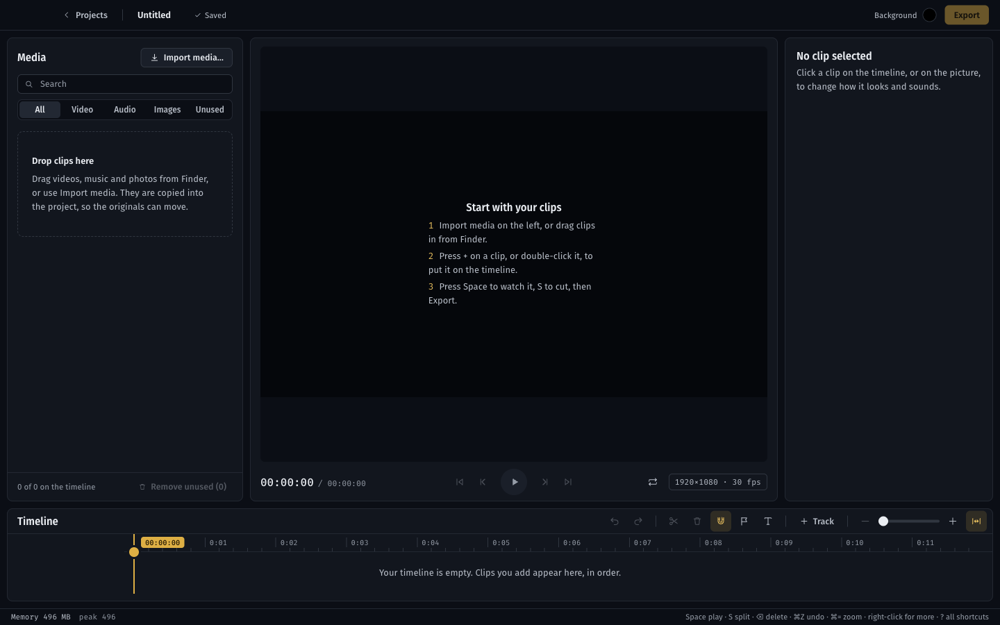
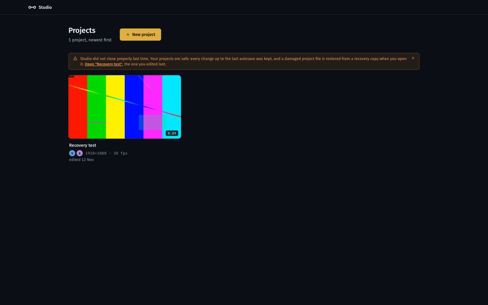
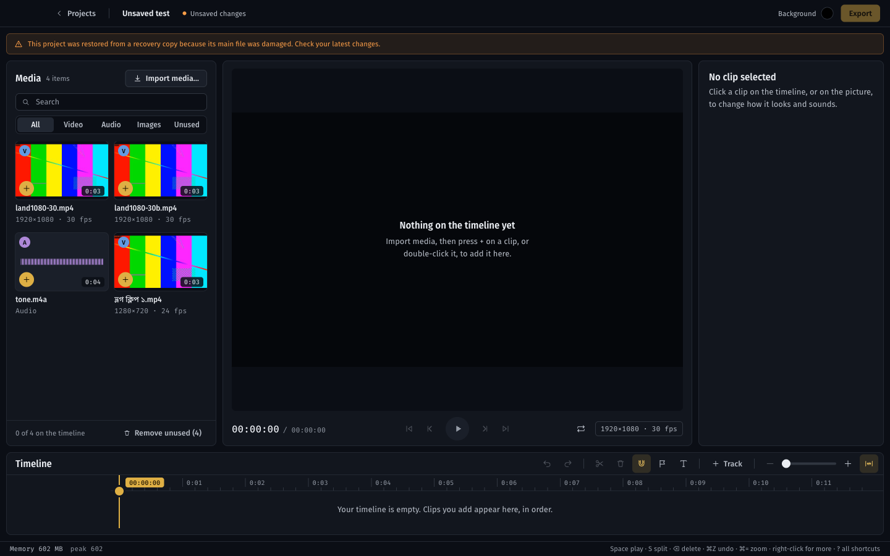
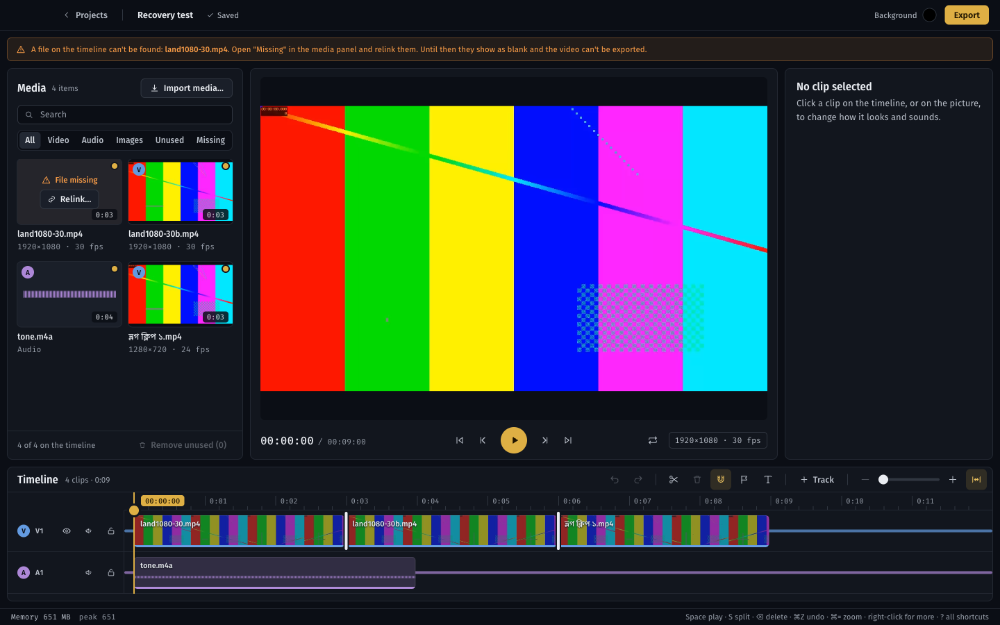
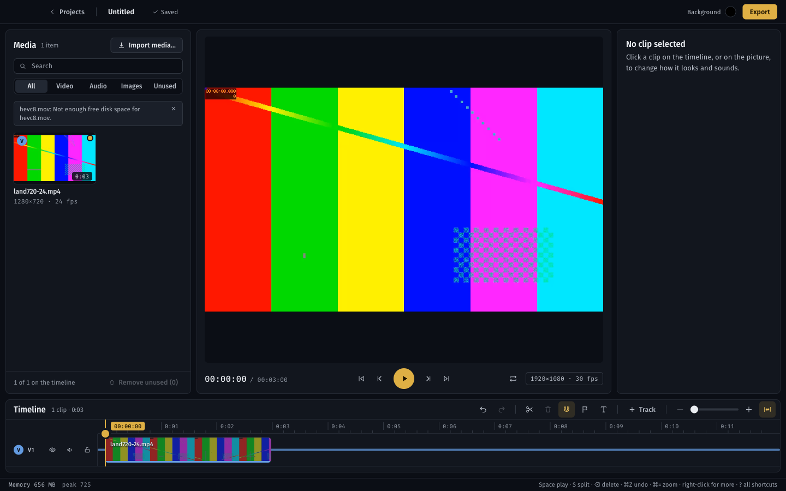
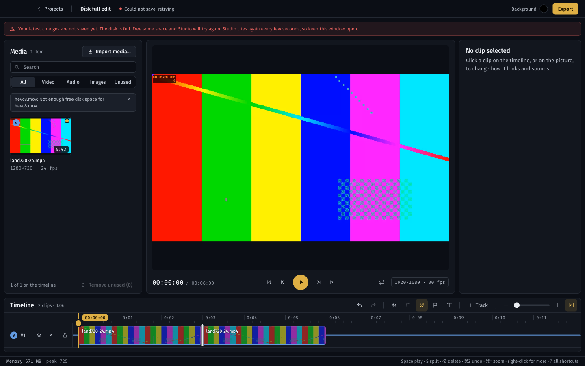

# M7 verification report

Generated 2026-11-12 21:57 by `scripts/verify/verify.py M7`.
Commit `5d4f8f4` (uncommitted changes present) · macOS-27.0.1-arm64-arm-64bit · 24GB RAM. The 8GB target Mac is a separate run; memory figures from other machines are indicative only.

**Result: 50/50 checks passed.**

## Static checks

| Check | Result | Detail |
|---|---|---|
| pnpm typecheck | pass | 0s |
| pnpm lint | pass | 0s |
| pnpm test (schema, store, import, crash) | pass | 0s |

## End-to-end checks (real Electron app, driven over CDP)

| Check | Result | Evidence |
|---|---|---|
| A fresh start in an empty folder shows no crash notice | pass |  |
| The empty dashboard explains what to do first | pass |  |
| ? opens the shortcut sheet from the dashboard | pass |  |
| The sheet groups shortcuts as Playback, Editing, Timeline view, Anywhere | pass | ['Playback', 'Editing', 'Timeline view', 'Anywhere'] |
| The sheet lists the keys the editor really handles | pass |  |
| Escape closes the sheet | pass |  |
| An empty project shows three first steps on the preview | pass |  |
| The media panel and timeline also say what goes there | pass |  |
| ? opens the sheet in the editor too, and Space then does not play | pass |  |
| Typing ? in a text field types it instead | pass |  |
| Two clips, music and a clip with a Bengali file name import and prepare | pass |  |
| The Bengali file name is kept as typed | pass | ['land1080-30.mp4', 'land1080-30b.mp4', 'tone.m4a', 'ভ্লগ ক্লিপ ১.mp4'] |
| All four assets are on the timeline | pass |  |
| After a force quit mid-edit the project file is whole and holds the last save | pass |  |
| The session lock was left behind by the killed app | pass |  |
| The next start says the last session did not close properly | pass | Studio did not close properly last time. Your projects are safe: every change up to the last autosave was kept, and a damaged project file is restored from a recovery copy when you open it. Open "Recovery test", the one you edited last. |
| The notice offers the project edited last | pass |  |
| Opening it restores the timeline exactly as last saved | pass |  |
| A project whose file is intact opens without the recovery banner | pass |  |
| The crash notice does not come back | pass |  |
| The local log records both starts and the unclean one | pass | 2 lines |
| A damaged project file is restored from a recovery copy, with a notice | pass | 0 tracks in the copy |
| With the file whole again it opens normally | pass |  |
| A file the timeline uses that is gone is reported in a banner that names it | pass | A file on the timeline can't be found: land1080-30.mp4. Open "Missing" in the media panel and relink them. Until then they show as blank and the video can't be exported. |
| The media panel marks it missing and offers Relink | pass |  |
| Playing across the missing clip does not crash the editor | pass | [] |
| Export refuses to start and names the missing file | pass | These files are missing, so the video cannot be exported: land1080-30.mp4. Relink them in the media panel. |
| Relinking brings the file back and clears the banner | pass |  |
| A file lost mid-export fails that export, keeps no file, and says which file | pass | The export did not finish. The file "ভ্লগ ক্লিপ ১.mp4" could not be read, so the export stopped. If it was moved or deleted, relink it in the media panel and export again. A log of this export is in the project's exports folder. |
| The failure is in the export history | pass |  |
| A 1.5 GB disk image is mounted for the disk-full checks | pass | sk6          	GUID_partition_scheme          	 /dev/disk6s1        	Apple_HFS                      	/Volumes/StudioSmallG: 'hdiutil attach -nobrowse ...' is deprecated. Please use 'diskutil image attach --mountOptions nobrowse ...' instead. |
| Import and proxy work on the small disk while it has room | pass |  |
| Importing with too little room is refused with the reason | pass | hevc8.mov: Not enough free disk space for hevc8.mov. |
| The refused import leaves no partial copy behind | pass |  |
| Export to a disk with too little room is refused with the reason | pass | Not enough free disk space: about 105 MB needed, 89 MB free. Free some space or choose another disk. |
| On a full disk the save state turns to an error | pass | 0 bytes free; Could not save, retrying |
| The error banner says the disk is full, in plain words | pass | Your latest changes are not saved yet. The disk is full. Free some space and Studio will try again. Studio tries again every few seconds, so keep this window open. |
| The project file on disk is still whole | pass |  |
| Leaving with unsaved edits asks first, and Cancel stays in the project | pass | ['Your latest changes could not be saved.\n\nThe disk is full. Free some space and Studio will try again.\n\nLeave anyway? Work since the last successful save is lost.'] |
| When space returns the save succeeds by itself | pass | Saved |
| The error banner goes away | pass |  |
| Soak: 1170 random edits and playbacks over 600s raised no page error | pass | [] |
| Soak: the editor tab stays under 600 MB | pass | peak 309 MB |
| Soak: total memory stays under 1200 MB | pass | peak 651 MB (dev machine; the 8GB run is separate) |
| Soak: the editor tab does not keep growing (end vs middle, under 80 MB) | pass | middle avg 269 MB, end avg 255 MB |
| Soak: undo history stays within its 200-step cap | pass | {'size': 159, 'canUndo': True, 'canRedo': False} |
| Soak: the project on disk is valid and equals the one in the editor after the soak | pass |  |

## Measurements

- screenshots: ['M7-dashboard-empty.png', 'M7-shortcuts.png', 'M7-editor-empty.png', 'M7-dashboard-crash-notice.png', 'M7-editor-recovered.png', 'M7-editor-missing-media.png', 'M7-import-no-space.png', 'M7-editor-disk-full.png']
- soak seconds: 600
- soak actions: {'undo': 170, 'split': 102, 'zoom': 84, 'select': 94, 'title': 74, 'seek': 104, 'duplicate': 99, 'delete': 94, 'play': 77, 'step': 94, 'redo': 92, 'marker': 86}
- soak memory samples: 108
- soak editor tab mb: {'first': 240, 'peak': 309, 'last': 276, 'mid_avg': 269, 'end_avg': 255}
- soak total mb: {'first': 629, 'peak': 651, 'last': 551}
- soak memory series s total tab: [[0, 629, 240], [17, 623, 282], [33, 639, 300], [49, 647, 306], [65, 585, 265], [82, 588, 269], [98, 505, 195], [115, 547, 243], [131, 605, 278], [148, 599, 277], [163, 601, 277], [181, 555, 252], [196, 612, 286], [214, 522, 218], [231, 590, 282], [249, 593, 279], [266, 595, 275], [282, 570, 266], [300, 574, 265], [316, 565, 259], [334, 587, 275], [350, 572, 275], [366, 565, 269], [383, 537, 250], [400, 545, 251], [418, 505, 214], [436, 556, 267], [454, 488, 232], [471, 514, 253], [488, 511, 248], [504, 511, 248], [523, 536, 270], [540, 503, 240], [557, 509, 250], [573, 552, 270], [589, 523, 259]]
- machine ram gb: 24

## Artifacts

- `/var/folders/yq/6trmhvwn3y1cngnbq6gh2mjh0000gn/T/studio-m7-yai1rgnr`

## Decisions and findings

Choices made with the user before building (Nov 12): the **update channel** is a manual one (Help, Check for Updates reads the project's GitHub releases page and opens the download page; no auto-update, because Squirrel.Mac needs a signed app); **crash reporting** is local only (a log file and local minidumps, a Report a Problem dialog that copies details, nothing sent anywhere); **signing** is unsigned with an ad-hoc signature (no paid Apple Developer account, so no notarisation); the **acceptance scenarios** are a checklist (`docs/release-checklist.md`) with what can be automated automated, and the 8GB-Mac hand runs listed. Schema v1 is unchanged.

- **Crash recovery.** `session.lock` in the projects folder (`packages/project-store/src/health.ts`) is written at start and removed on a clean quit (`will-quit`). A lock left behind whose process is dead means the last session did not end cleanly: the dashboard shows a notice once, offering the project edited last (`app:info` hands the flag out once). Autosave was already atomic with `.prev` and snapshots (M1). New: the editor window's own process dying (`render-process-gone`) shows a dialog and reloads it; a save that fails is retried every 5 seconds until it works, with a red banner saying why; leaving the project or closing the window while a save is failing asks first (`flushDone` now carries `{ok, error}`).
- **Missing media.** The editor shows a banner naming the missing files that the timeline uses (the media panel already had the Missing filter and Relink). Playback across a missing clip does not crash the editor (checked). Export refuses to start and names the files (M6); a file that vanishes during a render now fails with the file's name instead of `media://local/.../assets/<sha>.mp4: 404`, closing the M6 note.
- **Disk full.** Import already kept the file's size plus 1GB free (M2; found by the test, which first assumed no such rule). New: export checks the destination volume for about bitrate times length plus 100MB before it starts and says how much is needed and free; every IPC handler maps ENOSPC, EDQUOT, EROFS, EACCES and EIO to a plain sentence (`friendlyFsError`, `friendlyErrorText`), and the export `.part` write and the final rename do the same. Tested on a real 1.5GB disk image filled to the byte, not mocked.
- **Logs and crashes.** `studio.log` in `~/Library/Logs/Studio` (2MB, one rotated copy) records starts, IPC errors, uncaught errors in main, renderer errors (`app:log-error`, Zod-validated, length-capped) and process crashes. `crashReporter` runs with `uploadToServer: false`, so minidumps stay on the Mac. Help, Report a Problem shows version, macOS, memory, whether the last session ended badly and the last 40 log lines, with Copy and Show in Finder. No project names or media paths are added to it, but log lines can contain file paths.
- **Shortcut sheet** (`?` or Cmd+/, Help menu): one list in `shortcuts.ts`, which is what the sheet draws; `Editor.tsx`'s key handler is separate code, so the two must be kept in step by hand. **First run:** the empty project's preview shows three steps; the dashboard and the media panel already explained the empty state (M1, M2).
- **Performance pass.** Soak (e2e): random edits and playback for 10 minutes against the budget table, see the measurements. One change: the media queue is paused while an export runs (`MediaService.pause`/`resume`, driven by `ExportService`'s `onBusy`), so a proxy encode and a render never run together. The queue keeps its place and resumes afterwards.
- **Release build.** `pnpm release` runs `electron-forge package` and `scripts/make-dmg.sh` (ad-hoc `codesign`, then `hdiutil`), giving `apps/desktop/out/Studio-<version>-arm64.dmg` (about 130MB). The version is 0.7.0; make it 1.0.0 when Gate 2 passes. The packaged CSP drops `http://localhost:* ws://localhost:*` (a Vite plugin in `vite.renderer.config.ts`, build only), closing the README's "tighten the CSP" item. App icon: `apps/desktop/assets/icon.icns`, drawn by `make-icon.py` (the dashboard's line and two stations).
- **Finding (packaging, fixed):** `electron-forge package` exited silently with status 0 in the middle of unzipping Electron. Cause: `extract-zip` 2.0.1 depends on `yauzl` 2.10, which never finishes on Node 24 (a plain `yauzl` script hangs the same way), so the event loop emptied. Fixed with `pnpm.overrides` in the root `package.json` (`yauzl` 3.4.0; the existing overrides in `pnpm-workspace.yaml` are ignored by pnpm 10.0.0, the version this repo pins). Forge also refuses to package under pnpm unless a hoist pattern is set, so `.npmrc` states pnpm's own default pattern explicitly; this made pnpm reinstall `node_modules` once.
- **Finding (packaging, fixed):** Packager's `osxSign: {identity: "-"}` did nothing, and the bundle's signature was Electron's own, broken by Forge's edits (`codesign --verify` failed). `make-dmg.sh` now signs ad hoc itself and verifies.
- **Finding (recovery, by design, worth knowing):** a damaged `project.json` is restored from the newest valid copy, which is `.prev` (one save old) or a 30-second snapshot. In the test that copy was from before the clips were added to the timeline, so a torn main file can cost the last save's edits. The atomic writer makes a torn file very unlikely; the banner tells the user to check their latest changes.
- **Packaged smoke test** (not part of `verify.py`, run by hand with `--user-data-dir` pointing at a temporary folder): the app copied out of the DMG launches, loads over `file://`, shows the empty dashboard, creates a project, opens the shortcut sheet, reports version 0.7.0, has the CSP without localhost, no page errors, `isE2E` false, and shows 463MB total in the memory readout.

## Visual baselines

Updated on purpose: `editor-empty` and `editor-vertical-empty` (the preview now shows three first steps in an empty project). New: `dialog-shortcuts`. The banners and notices of this milestone have screenshots in this report instead (`M7-dashboard-crash-notice`, `M7-editor-missing-media`, `M7-editor-disk-full`, `M7-import-no-space`, `M7-editor-recovered`), because they need a killed app or a full disk to appear.

## Not built, and known limits

- **Not run here:** Gate 2 (a real 5-minute 1080p export on the 8GB Mac with real footage, sync at 5 minutes, the 1.5GB peak), the memory bars on the 8GB Mac (the soak ran on the dev Mac), a clean Cmd+Q followed by a start with no crash notice (a native quit cannot be sent from the test; the lock logic is unit tested), Help, Check for Updates against GitHub (a native menu, and the repository has no published release to find; its parsing and version comparison are unit tested), Report a Problem and the close-window dialog (native dialogs), and an unsigned DMG opened with right-click, Open on a Mac that never saw the build (Gatekeeper). All are rows in `docs/release-checklist.md`.
- The check for updates sends one GET to `api.github.com` with no identifying data; it is the only network call the app makes, and only when asked. It cannot install anything.
- Notarisation is not done. macOS will say the app is from an unidentified developer until it is opened once with right-click, Open.
- Crash dumps (`.dmp`) are written locally but nothing reads them; they are there for a person to attach to a report.
- The shortcut list and the key handler are two copies of the same facts (see above).
- Disk-full on import relies on the M2 rule (the file plus 1GB free), so a nearly full disk refuses imports sooner than strictly needed.
- The packaged app was built for Apple Silicon (arm64) only, on this Mac.
